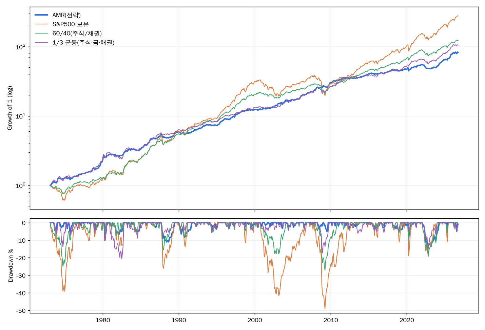

# autotrader — 주식·금·채권·지수ETF 멀티에셋 알고리즘 자동매매

국내 상장 ETF 7종(한국주식·미국주식·미국성장주·금·한국채·미국채·현금성)을 대상으로
**월 1회 규칙 기반 자산배분 → 증권사 API 자동 주문**까지 처리하는 파이썬 시스템입니다.

- **기본 증권사: NH투자증권 나무 PLUG Open API** (API 전용 수수료 국내 0.01%, 조사 대상 중 최저)
- 대안 증권사: 한국투자증권 KIS Developers (동일 인터페이스로 설정 한 줄만 바꾸면 전환)
- 기본 전략: **AMR(Adaptive Momentum Risk-parity)**: 절대·상대 모멘텀 + 역변동성 배분 + 변동성 타기팅
- 선택 기능: **딥러닝 오버레이**(GRU + 자산 간 Transformer). 워크포워드 검증을 통과했을 때만 반영

> ⚠️ 투자 손실 책임은 사용자에게 있습니다. 반드시 **모의투자(mock) → 드라이런 → 소액 실계좌** 순서로 검증하세요.

---

## 1. 어떤 증권사 API를 쓰나 (수수료 비교, 2026-11 조사)

| 증권사 | 개인용 API | API 매매 수수료(국내) | 해외 | 비고 |
|---|---|---:|---:|---|
| **NH투자증권 나무 PLUG** ✅ | REST + WebSocket (2026-08 출시) | **0.01%** | **0.09%** | API 신청 후 12개월 수수료 우대 이벤트. 사용자가 주로 쓰는 나무 계좌를 그대로 사용 |
| 한국투자증권 KIS | REST + WebSocket (2022~) | 계좌 온라인 수수료와 동일(뱅키스 약 0.014%, 일반 0.147%) | 0.25%(기본) | 별도 API 이용료 없음. 모의투자 환경이 성숙함 |
| 미래에셋증권 | **미출시**(준비 중 보도) | - | - | 자동매매 불가 → 제외 |

- 위 수수료와 별도로 유관기관 제비용 0.0036396%가 매수·매도 양쪽에 붙습니다. 시스템은 NH 요율에 이를 **별도 가산**해 보수적으로 계산합니다.
- 국내 상장 ETF는 **증권거래세가 면제**되어, ETF 전략에서는 증권사 수수료가 사실상 유일한 거래비용입니다.
- `autotrader fees` 명령으로 회전율·운용금액별 연간 비용을 비교할 수 있습니다. 본인 계좌 요율은 `costs.commission_rate`로 덮어쓰세요.

결론: **수수료가 가장 싸고, 주 거래 증권사(나무)라 계좌를 새로 만들 필요가 없는 NH 나무 PLUG를 기본**으로 하고,
API가 더 오래 검증된 KIS를 예비로 붙였습니다.

### NH PLUG 구현 근거
NH투자증권 공식 국내주식 OpenAPI 명세(API명세서 261015, openapi.json)와 공식 SDK(`PLUG-OpenAPI/nhplug-sdk`) 기준으로 구현했습니다.
- 토큰 `POST /oauth2/token`(운영 도메인 전용, 24시간, 파일 캐시 재사용) · 헤더 `authorization: Bearer` 하나 · 요청 `{"Input_0": …}`
- 주문 `cashBuy/cashSell/cancel`, 잔고 `balance`, 체결 `dailyOrderExecution`, 시세 `currentPrice/period`
- 시세 API는 **운영 전용**이라 모의투자 모드에서도 시세는 운영 도메인에서 받고, 주문·잔고만 모의 도메인(`moapi`)으로 보냅니다.
- 업무 성공 판정은 명세 권고대로 `rsp_cd` 비교가 아니라 "기대한 Output 블록이 왔는가 + `rsp_msg`"로 합니다.
- 계좌는 `/n2/acctinfo`의 `acct_type`(01·02=운영, 03=모의)으로 환경에 맞는 계좌를 자동 선택합니다.

> 이 저장소의 어댑터는 **명세와 공식 SDK의 요청·응답 형식을 재현한 테스트**로 검증했습니다. 개발 환경에서는 증권사 서버에 접속할 수 없어서 실서버 호출은 해보지 못했습니다.
> 따라서 **첫 사용은 반드시 모의투자에서** `account → signal → rebalance --dry-run → rebalance` 순서로 확인하세요.

---

## 2. 전략: AMR (적응형 모멘텀 리스크패리티)

실증 근거가 가장 두터운 요소만 결합하고, 조정할 파라미터 수는 최소화했습니다.

| 단계 | 규칙 | 근거 |
|---|---|---|
| ① 절대 모멘텀 | 3·6·12개월 수익률 평균이 **현금(CD금리 ETF)보다 낮은 자산은 보유하지 않음** | 시계열 모멘텀(Moskowitz·Ooi·Pedersen 2012). 장기 하락장의 손실을 차단 |
| ② 상대 모멘텀 | 6개 위험자산 중 점수 상위 **3개**만 후보 | 횡단면 모멘텀(Antonacci 2014, Faber 2007) |
| ③ 리스크패리티 | 후보 간 **역변동성 비중**(옵션: ERC), 종목당 최대 40% | 변동성 큰 자산을 줄여 위험을 고르게 분산 |
| ④ 변동성 타기팅 | 포트폴리오 예상 변동성이 **연 10%를 넘으면 비례 축소**(레버리지 없음) | Moreira·Muir 2017 |
| ⑤ 나머지 | 현금성 ETF(KODEX CD금리액티브) | 대기자금도 금리를 받음 |
| ⑥ 매매 | **월 1회**(첫 거래일 09:30) + 월중 비중이탈 8%p 초과 시 재조정 + 1% 노트레이드 밴드 | 회전율·수수료 최소화 |

신호는 **전일 종가까지만** 사용하고(미래참조 없음), 다음 거래일에 체결합니다. 백테스트도 같은 시점 규칙을 씁니다.

### 운용 유니버스 (`config/default.yaml`)
| 자산군 | 종목 | 코드 |
|---|---|---|
| 한국주식 | KODEX 200 | 069500 |
| 미국주식 | TIGER 미국S&P500 | 360750 |
| 미국성장주 | TIGER 미국나스닥100 | 133690 |
| 금 | ACE KRX금현물 | 411060 |
| 한국장기채 | KODEX 국채선물10년 | 152380 |
| 미국장기채 | TIGER 미국채10년선물 | 305080 |
| 현금성 | KODEX CD금리액티브(합성) | 459580 |

채권은 분배금이 거의 없는 **국채선물형**을 골랐습니다. 분배금이 큰 ETF는 가격 기준 모멘텀이 실제보다 낮게 잡혀 신호가 왜곡되기 때문입니다.
종목명은 운용사 리브랜딩으로 바뀔 수 있어 코드 기준으로 관리하며, YAML에서 자유롭게 바꿀 수 있습니다.

---

## 3. 검증 결과: 53년 실데이터 백테스트

국내 ETF는 상장 기간이 짧아(대부분 2010년 이후) 수십 년 검증이 불가능합니다. 그래서 **같은 자산군의 장기 실데이터**
(S&P500 총수익·금·미국채10년, 1973~2026.09, 공개 데이터셋)로 전략 로직을 검증했습니다.
`autotrader backtest --data research_us` 하나로 재현할 수 있습니다. 상세 리포트는 [`reports/backtest_research_us.md`](reports/backtest_research_us.md)에 있습니다.

| 전략 | CAGR | 변동성 | Sharpe | 최대낙폭(MDD) | 최악의 해 | 최장 회복 |
|---|---:|---:|---:|---:|---:|---:|
| **AMR(전략)** | **8.6%** | **6.5%** | **1.30** | **-13.3%** | -12.2% | 2.2년 |
| S&P500 보유 | 11.0% | 12.6% | 0.90 | -49.0% | -39.2% | 6.1년 |
| 60/40 | 9.4% | 8.2% | 1.14 | -27.2% | -19.5% | 3.3년 |
| 1/3 균등(주식·금·채권) | 9.1% | 7.6% | 1.18 | -20.6% | -9.9% | 2.0년 |

| 위기 구간 | AMR | S&P500 | 60/40 |
|---|---:|---:|---:|
| 오일쇼크(1973-74) | **+28.5%** | -39.2% | -23.1% |
| 닷컴 붕괴(2000.09-2002.09) | **+13.4%** | -39.2% | -16.7% |
| 금융위기(2007.10-2009.02) | **+14.0%** | -46.0% | -24.8% |
| 2022 금리 급등 | -11.6% | -17.6% | -16.8% |



### 결과 해석
- **강점**: 위험 1단위당 수익(Sharpe 1.30)이 가장 높고, 최대낙폭은 S&P500의 약 1/4입니다. 스태그플레이션·버블 붕괴·금융위기에서 오히려 수익을 냈습니다.
- **약점**: 2019~2021·2023 같은 강한 상승장에서는 주식 단일 보유보다 덜 법니다. **절대 수익률(CAGR)은 S&P500보다 낮습니다.**
- **보수적 가정**: 무료 단기금리 데이터를 구할 수 없어 **현금 수익률을 0%로** 두었습니다. 현금 비중이 있는 AMR에만 불리한 가정입니다
  (실운용에서는 CD금리 ETF가 이자를 받습니다). 월평균 가격 데이터의 자기상관 편향을 없애려고 **체결을 1개월 늦췄고**,
  수수료 0.0136%와 슬리피지 5bp를 반영했습니다.
- 수익을 더 원하면 `target_vol`을 0.14로 올리거나 끄면 됩니다. 아래 민감도 표를 참고하세요.

### 과최적화 점검: 파라미터 민감도
기본값 하나만 좋은 게 아니라 **주변 파라미터 전반에서** 우위가 유지되는지 144개 조합으로 확인했습니다
(lookback 4종 × top_k 3종 × 목표변동성 4종 × 비중방식 3종, [`reports/sensitivity.md`](reports/sensitivity.md)).

| top_k | 조합 | 60/40보다 Sharpe 높음 | 60/40보다 MDD 얕음 | Sharpe 범위 | 최악 MDD |
|---|---:|---:|---:|---:|---:|
| 1 (1개 자산 집중) | 48 | 0% | 19% | 0.78~0.97 | -34.7% |
| **2 이상 (분산)** | **96** | **99%** | **100%** | **1.13~1.33** | **-16.9%** |

- 위험자산을 **2개 이상 분산 보유**하면 lookback·목표변동성·비중방식을 어떻게 바꿔도 결과가 거의 같습니다. 특정 파라미터에 맞춘 결과가 아니라는 뜻입니다.
- 반대로 **1개 자산 집중(top_k=1)은 취약**합니다. 그래서 기본값은 6개 중 3개(절반)입니다.

---

## 4. 딥러닝 오버레이 (선택)

`src/autotrader/ml/`: **CrossAssetTemporalNet**
- 자산마다 **가중치를 공유하는 GRU**로 최근 시퀀스(위험조정 모멘텀 4종, 변동성비, 이동평균 이격, 낙폭, 횡단면 순위)를 요약하고,
  **Transformer 셀프어텐션**으로 자산 간 관계(위험선호/회피 국면)를 학습합니다.
- 목표: 다음 1개월 **변동성 조정 초과수익의 상대 순위**. 손실은 Huber + ListNet 순위손실입니다.
- **워크포워드**: 12개월마다 그때까지의 데이터로만 재학습하고, 학습 타깃이 테스트 구간과 겹치지 않도록 퍼지(purge)합니다. 조기종료와 다중 시드 앙상블을 씁니다.
- **이중 검증 게이트**: ① 표본외 순위 IC 평균 ≥ 0.02이고 t ≥ 2.0, ② 같은 표본외 예측으로 백테스트했을 때 **포트폴리오 Sharpe가 개선**될 것.
  둘 다 통과한 모델만 실거래에 반영됩니다(`ml.require_validation`).
- **안전 설계**: ML은 **순위만 보정**합니다. 실제 모멘텀이 현금보다 낮은 자산은 ML 점수가 높아도 사지 않습니다.

### 검증 결과: 기본값은 ML **꺼짐**
53년 실데이터, 50개 워크포워드 폴드, 표본외 595개월로 검증했습니다([`reports/ml_research.md`](reports/ml_research.md)).

| 검증 | 순위 IC | t값 | AMR Sharpe → AMR+ML Sharpe |
|---|---:|---:|---:|
| 타깃 지연 없음(t→t+1, `MLConfig(target_gap_bars=0)`) | 0.110 | 3.83 | (겉보기로만 유의) |
| **타깃 1바 지연(실제 체결 시점과 일치)** | **0.065** | **1.56** | **1.30 → 1.25 (악화)** |

- 지연 없이 측정하면 매우 좋아 보이지만, 예측력의 약 40%는 **월평균 가격 데이터의 인위적 자기상관**이었습니다. 실제로는 거래할 수 없는 신호입니다.
- 체결 시점에 맞춰 다시 재면 예측력은 약하고, AMR이 이미 쓰는 모멘텀 정보와 겹쳐 **포트폴리오 성과가 오히려 나빠집니다.**
- 그래서 게이트를 강화했고(t ≥ 2.0, 포트폴리오 개선 필수), **기본 운용은 순수 AMR**입니다. 운용 ETF의 일봉으로 `ml-validate`를 돌려 두 게이트를 모두 통과할 때만 켜세요.
  검증되지 않은 딥러닝을 돈에 연결하지 않는 것이 이 시스템의 원칙입니다.

```bash
autotrader ml-validate --data broker          # 운용 ETF 실제 일봉으로 검증 → 통과 시 models/ml_overlay.pt 저장
# config: ml.enabled: true  (검증 통과 모델만 반영됨)
```

---

## 5. 시스템 구조

```
src/autotrader/
├── brokers/        nh_plug.py(기본) · kis.py · paper.py(모의체결) · base.py(공통 인터페이스)
├── strategy/       amr.py(기본 전략) · signals.py(모멘텀·변동성·ERC) · benchmarks.py
├── ml/             features.py · model.py(GRU+Transformer) · train.py(워크포워드·게이트)
├── portfolio/      rebalancer.py(목표비중→1주 단위 주문) · risk.py(안전장치)
├── execution/      engine.py(실행엔진·스케줄러) · state.py(SQLite 이력)
├── backtest/       engine.py(이벤트 기반) · metrics.py · report.py
├── data/           research.py(장기 실데이터) · loader.py(일봉 캐시) · synthetic.py
├── calendar.py     KRX 거래일(공휴일·대체공휴일·연말·근로자의날)
├── ticks.py        KRX 호가단위 · fees.py 수수료 모델 · config.py · cli.py
```

**실행 흐름(매 거래일 09:30)**: 안전점검 → 리밸런싱 필요 여부 → 전일 종가 기준 목표비중 → 주문계획·위험한도 점검 →
**매도 → 매수**(라운드마다 실제 잔고를 다시 조회해 남은 차이만 주문, 미체결은 취소 후 재주문, 마지막 라운드는 시장가) → 기록·알림

### 나만의 전략 추가하기
`Strategy`를 상속해 `target_weights()` 하나만 구현하면 백테스트·실거래 엔진을 그대로 씁니다.
```python
from autotrader.strategy.base import Strategy, StrategyContext
from autotrader.strategy.signals import above_sma

class TrendFollow(Strategy):          # 예: 10개월 이동평균 위 자산만 균등 보유
    name = "trend"
    def __init__(self, assets, cash): self.assets, self.cash = assets, cash
    def symbols(self): return self.assets + [self.cash]
    def warmup_bars(self, bars): return bars.bars(10)
    def target_weights(self, prices, ctx: StrategyContext):
        ok = above_sma(prices[self.assets], ctx.bars.bars(10))
        w = (ok / len(self.assets)).astype(float)
        w[self.cash] = 1 - w.sum()
        return w
```
`run_backtest(prices, TrendFollow([...], "459580"))`로 바로 검증할 수 있습니다. 실거래에 쓰려면 `strategy/__init__.py`의 `build_strategy`에 등록하세요.

### 안전장치
- `broker.env: mock`이 기본값입니다. live로 바꿔도 환경변수 `AUTOTRADER_LIVE_CONFIRM=I_UNDERSTAND_THE_RISK`가 없으면 주문하지 않습니다.
- **킬스위치**: 작업 폴더에 `STOP` 파일을 만들면 즉시 중단합니다(`touch STOP`).
- 1회 회전율 상한, 주문 1건 금액 상한, 전일 대비 ±10% 이상 이상시세 시 중단, 지정가 괴리 3% 초과 금지
- **이중주문 방지**: 주문 API는 네트워크 오류 시 자동 재전송하지 않습니다. 라운드 시작 전 미체결을 취소하고, 취소가 확인되지 않으면 중단합니다.
- `risk.capital_limit`: 계좌 중 이 전략에 쓸 금액 상한. 유니버스 밖의 보유종목은 건드리지 않습니다.
- 토큰은 파일 캐시(권한 0600)로 재사용합니다(NH는 재발급 시 보안 알림, KIS는 1분 1회 제한). 키는 `.env`에만 두며 커밋 금지입니다.

---

## 6. 설치와 사용

```bash
git clone <repo> && cd <repo>
python -m venv .venv && source .venv/bin/activate
pip install -e ".[report,dev]"          # 딥러닝까지: pip install -e ".[ml,report,dev]"
cp .env.example .env                    # NHPLUG_APP_KEY / NHPLUG_APP_SECRET 입력
```

**NH 나무 PLUG 준비**: [nhplug.com](https://www.nhplug.com)에서 API 사용 신청 → APP KEY/SECRET 발급 → 모의투자 신청(모의투자 계좌 acct_type=03)

```bash
autotrader fees                                  # 증권사 수수료 비교
autotrader backtest --data research_us           # 53년 실데이터 검증 → reports/
autotrader backtest --data broker --start 2018-01-01   # 운용 ETF 실제 일봉으로 검증(API 키 필요)
autotrader account                               # 모의계좌 잔고
autotrader signal                                # 오늘 목표비중(주문 없음)
autotrader rebalance --dry-run --force           # 주문계획만 출력
autotrader rebalance --force                     # 모의투자로 실제 주문 1회
autotrader daemon                                # 매 거래일 09:30 자동 실행
autotrader status                                # 실행 이력
```

**상시 운영(리눅스 서버/클라우드 VM)**: `autotrader daemon`을 systemd 서비스로 띄우거나, cron으로 평일 09:30에 `autotrader rebalance`를 실행합니다.
```cron
30 9 * * 1-5  cd /opt/autotrader && .venv/bin/autotrader --config config/my.yaml rebalance >> logs/cron.log 2>&1
```
휴장일은 캘린더가 알아서 건너뜁니다. 실계좌 전환은 `broker.env: live` + `.env`에 `AUTOTRADER_LIVE_CONFIRM=I_UNDERSTAND_THE_RISK`로 합니다.

KIS로 바꾸려면 `broker.name: kis`, `costs.preset: kis_bankis`로 설정하고 `.env`에 `KIS_APP_KEY / KIS_APP_SECRET / KIS_ACCOUNT=12345678-01`을 넣습니다.

### 테스트
```bash
pytest -q        # 전략·백테스트(미래참조 검증)·리밸런서·호가·캘린더·NH/KIS 어댑터·실행엔진 E2E·ML
python scripts/sensitivity.py   # 파라미터 민감도(144 조합)
python scripts/ml_research.py   # 딥러닝 오버레이 워크포워드 + 포트폴리오 게이트 검증
```

---

## 7. 한계와 주의
- 과거 성과가 미래 수익을 보장하지 않습니다. 모멘텀 전략은 **급반전 장세**(1987, 2020.03)에 짧게 손실을 볼 수 있습니다.
- 장기 검증은 미국 자산 대리 데이터입니다. 실제 운용 ETF는 `--data broker`로 반드시 재검증하세요.
- 국내 상장 해외 ETF의 매매차익·분배금은 배당소득세(15.4%) 과세 대상입니다. ISA·연금계좌에서 운용하면 절세에 유리합니다(API 지원 여부는 증권사에 확인하세요).
- NH PLUG는 2026년 출시된 신규 API라 명세가 자주 바뀝니다. 오류 시 [nhplug.com](https://www.nhplug.com) 명세를 확인하세요.
