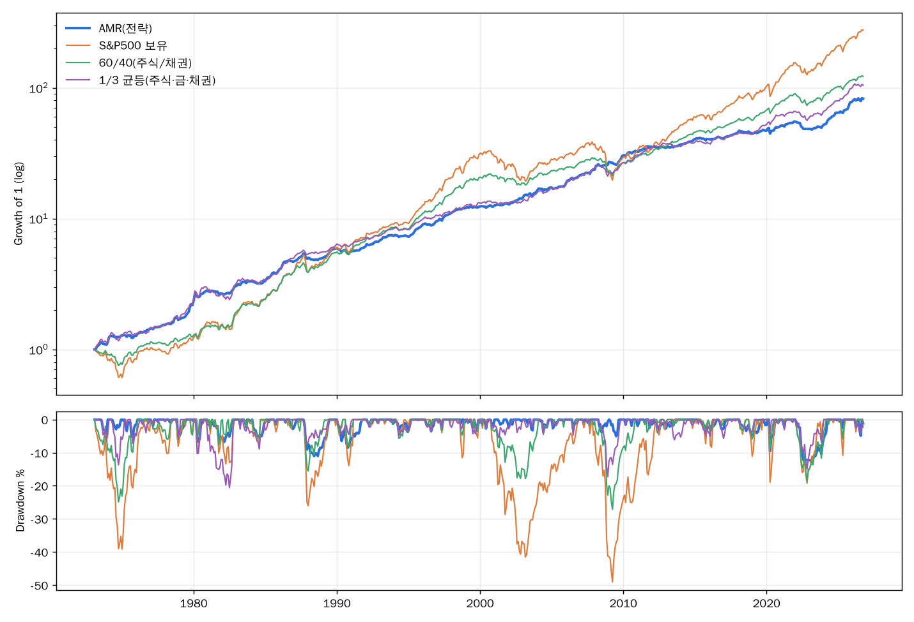
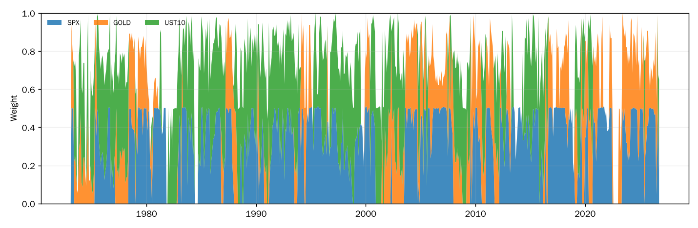

# 백테스트 리포트 — research_us

- 메타: `{"spx_dividend_estimated_from": "2023-07", "spx_dividend_yield_assumed": 0.0167, "last_month": "2026-09"}`
- 비용: NH투자증권 나무 PLUG(API) 0.0136% + 슬리피지 5bp, 체결지연 1바

## 성과 요약

| 전략 | CAGR | 변동성 | Sharpe | Sortino | MDD | Calmar | 최악의 해 | 최장 회복(년) | 연회전율 | 최종배수 |
|---|---:|---:|---:|---:|---:|---:|---:|---:|---:|---:|
| AMR(전략) | 8.6% | 6.5% | 1.30 | 2.62 | -13.3% | 0.65 | -12.2% | 2.20 | 2.88 | 82.53x |
| S&P500 보유 | 11.0% | 12.6% | 0.90 | 1.36 | -49.0% | 0.23 | -39.2% | 6.10 | 0.00 | 276.34x |
| 60/40(주식/채권) | 9.4% | 8.2% | 1.14 | 1.92 | -27.2% | 0.35 | -19.5% | 3.30 | 0.13 | 122.43x |
| 1/3 균등(주식·금·채권) | 9.1% | 7.6% | 1.18 | 2.25 | -20.6% | 0.44 | -9.9% | 2.00 | 0.19 | 104.67x |

## 위기 구간 수익률

| 위기 구간 | AMR(전략) | S&P500 보유 | 60/40(주식/채권) | 1/3 균등(주식·금·채권) |
|---|---:|---:|---:|---:|
| 오일쇼크·스태그플레이션 (1973-01~1974-12) | 28.5% | -39.2% | -23.1% | 26.4% |
| 블랙먼데이 (1987-08~1987-12) | -7.5% | -26.0% | -15.6% | -6.8% |
| 닷컴버블 붕괴 (2000-09~2002-09) | 13.4% | -39.2% | -16.7% | -1.6% |
| 글로벌 금융위기 (2007-10~2009-02) | 14.0% | -46.0% | -24.8% | -4.9% |
| 코로나 쇼크 (2020-01~2020-03) | -8.5% | -18.8% | -7.8% | -2.9% |
| 2022 금리 급등 (2022-01~2022-10) | -11.6% | -17.6% | -16.8% | -13.9% |

## 연도별 수익률

| 연도 | AMR(전략) | S&P500 보유 | 60/40(주식/채권) | 1/3 균등(주식·금·채권) |
|---|---:|---:|---:|---:|
| 1973 | 13.2% | -17.7% | -9.3% | 14.1% |
| 1974 | 13.5% | -26.1% | -15.3% | 10.9% |
| 1975 | -1.0% | 38.0% | 23.7% | 3.4% |
| 1976 | 14.6% | 22.5% | 20.3% | 12.1% |
| 1977 | 5.2% | -6.3% | -3.1% | 4.7% |
| 1978 | 10.8% | 7.8% | 4.7% | 12.4% |
| 1979 | 38.5% | 18.2% | 11.0% | 39.0% |
| 1980 | 18.0% | 30.2% | 16.6% | 17.7% |
| 1981 | -3.9% | -2.5% | 2.3% | -6.0% |
| 1982 | 14.7% | 19.2% | 26.0% | 21.6% |
| 1983 | 8.1% | 23.2% | 15.0% | 4.2% |
| 1984 | 0.7% | 4.7% | 9.0% | 0.4% |
| 1985 | 23.2% | 31.4% | 29.8% | 19.3% |
| 1986 | 14.3% | 24.1% | 24.3% | 23.9% |
| 1987 | 6.7% | -0.1% | -0.9% | 7.2% |
| 1988 | -0.5% | 18.8% | 14.6% | 4.0% |
| 1989 | 19.5% | 30.2% | 25.5% | 15.0% |
| 1990 | -5.7% | -2.4% | 1.5% | -0.6% |
| 1991 | 9.1% | 22.1% | 19.7% | 11.0% |
| 1992 | 11.4% | 15.5% | 13.2% | 5.6% |
| 1993 | 8.8% | 10.0% | 11.6% | 13.0% |
| 1994 | -2.3% | 0.5% | -2.6% | -2.6% |
| 1995 | 24.4% | 38.4% | 32.5% | 20.9% |
| 1996 | 5.9% | 23.6% | 14.7% | 6.6% |
| 1997 | 15.8% | 31.8% | 23.0% | 4.9% |
| 1998 | 8.9% | 25.5% | 21.8% | 13.9% |
| 1999 | 2.9% | 21.6% | 9.7% | 4.1% |
| 2000 | 1.5% | -5.8% | 2.2% | 1.5% |
| 2001 | 1.7% | -12.8% | -4.9% | -1.1% |
| 2002 | 13.3% | -20.2% | -7.4% | 3.7% |
| 2003 | 13.5% | 22.3% | 14.0% | 15.7% |
| 2004 | 4.9% | 12.8% | 9.6% | 8.7% |
| 2005 | 7.8% | 7.1% | 5.2% | 8.3% |
| 2006 | 15.3% | 14.3% | 10.2% | 14.3% |
| 2007 | 10.1% | 6.3% | 7.3% | 14.1% |
| 2008 | 14.7% | -39.2% | -19.5% | -8.3% |
| 2009 | 12.1% | 30.0% | 14.5% | 20.1% |
| 2010 | 6.2% | 14.0% | 11.0% | 14.3% |
| 2011 | 9.0% | 2.1% | 7.5% | 12.5% |
| 2012 | -1.1% | 16.8% | 11.8% | 7.9% |
| 2013 | 5.8% | 29.7% | 13.4% | -4.0% |
| 2014 | 9.9% | 15.9% | 13.1% | 7.6% |
| 2015 | -0.2% | 2.0% | 2.1% | -2.2% |
| 2016 | 1.4% | 11.7% | 7.0% | 6.7% |
| 2017 | 10.8% | 20.9% | 13.6% | 11.0% |
| 2018 | -1.7% | -1.8% | -1.2% | -1.0% |
| 2019 | 5.1% | 26.2% | 20.1% | 18.7% |
| 2020 | 9.3% | 18.5% | 16.5% | 18.9% |
| 2021 | 7.7% | 28.3% | 14.7% | 6.2% |
| 2022 | -12.2% | -15.0% | -14.8% | -9.9% |
| 2023 | 7.7% | 21.8% | 12.9% | 11.4% |
| 2024 | 23.8% | 30.5% | 18.0% | 20.2% |
| 2025 | 21.8% | 15.9% | 12.3% | 26.9% |
| 2026 | 4.9% | 13.3% | 6.5% | 3.6% |

