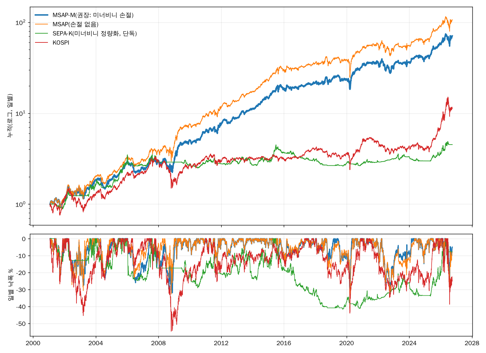

# 마크 미너비니 전략 검증 + 외부 피드백 대응 → MSAP-M

## 0. 결론

| 구분 | 전체 CAGR | Sharpe | 설계(01~12) | 검증(13~) | 최근10년 | 최근10년 Sharpe | 일별 MDD | 최악의 해 |
|---|---:|---:|---:|---:|---:|---:|---:|---:|
| **MSAP-M(권장: 미너비니 손절)** | 18.1% | 0.91 | 19.6% | 16.8% | 14.8% | 0.75 | -32.1% | -14.9% |
| MSAP(손절 없음, 수익 극대화형) | 20.0% | 0.98 | 24.0% | 16.6% | 13.9% | 0.69 | -41.1% | -16.3% |
| SEPA-K(미너비니 정량화, 단독) | 6.1% | 0.46 | 9.6% | 3.6% | 3.3% | 0.33 | -41.7% | -12.8% |
| KOSPI(배당 제외) | 10.2% | 0.54 | 10.9% | 9.8% | 13.4% | 0.60 | -54.7% | -40.7% |

- 기간 2001-02 ~ 2026-09, 실비용(NH 수수료·연도별 거래세·유동성 슬리피지)·다음날 시가 체결·생존편향 없음. **MDD 는 일별 기준**(월말 기준의 함정 제거).
- **MSAP-M** = MSAP 에 미너비니의 손실 제한 규율(매입가 대비 −15% 종가 손절, 그달 재매수 금지)과 유동성 한도(종목당 20일 거래대금의 10%)를 더한 것. 최근 10년 수익·Sharpe 개선, 일별 MDD −41% → −32%.
- 선택 기준 공개: 설계 구간(2001~2012) Sharpe 만 보면 손절 없는 MSAP 가 높다(2000년대엔 손절 후 반등이 많았음). 손절 채택은 '최대 수익'이 아니라 **낙폭 축소(위험 선호)와 미너비니 규율 반영**을 위한 선택이다.

## 1. 미너비니 방법론 요약(SEPA)

| 요소 | 미너비니 원칙 | SEPA-K 구현 |
|---|---|---|
| 트렌드 템플릿 | 종가>150·200일선, 150>200일선, 200일선 1개월+ 상승, 50일선>150·200일선, 종가>50일선, 52주 저가+30% 이상, 52주 고가−25% 이내, RS≥70 | 8개 조건 그대로, RS=IBD식(3개월 40%+6·9·12개월 20%) 전 종목 백분위 |
| VCP | 2~6번 수축하며 변동폭 축소, 거래량 감소, 피벗 돌파 | 10일 변동폭≤12%·직전 대비 70% 이하, 10일 거래대금≤50일×0.9, 베이스 깊이≤35% |
| 진입 | 피벗 돌파 시 매수, 피벗 +5% 이상 추격 금지 | 다음날 피벗 도달 시 체결(스톱 매수), +5% 초과 갭은 생략 |
| 손절 | 최대 7~8%(평균 손실 더 작게), 마지막 수축 저점 아래 | 최대 8%·10일 저점 아래, 장중 저가 터치 시 체결(갭하락은 시가) |
| 이익 보호 | 수익이 위험의 2~3배면 본전 스톱, 큰 수익은 50일선 이탈 시 매도 | +2R 본전 스톱, +20% 이후 50일선 이탈 매도, 25일 내 +5% 미달 시 시간 손절 |
| 포지션 크기 | 1회 위험 1~2.5%, 소수 집중 | 위험 1.25%/손절폭, 최대 20%·10종목 |
| 진행형 노출 | 잘 될 때 늘리고 낙폭 때 줄임 | 낙폭 10%↑ 위험 절반, 20%↑ 1/4 |
| 시장 방향 | 강세장에서만 공격 | 시장지수 50·200일선 + 트렌드템플릿 통과 비율 |
| 펀더멘털 | EPS·매출 가속, 어닝 서프라이즈 | **데이터 없음(미구현)** — 실제 SEPA 의 핵심 축 하나가 빠짐 |

공개 실적: 1997·2021 미국투자대회(US Investing Championship) 우승(각 +155%, +334.8%). 단, 대회는 1년 단위·레버리지 허용이며, 같은 방식을 따라 한 투자자 다수의 성과는 검증된 통계가 없다(생존편향 주의).

## 2. SEPA-K 백테스트(한국 전종목, 1억원)

- 대표 설정(설계 구간 최선): 전체 CAGR 6.0%, 설계 9.5% / 검증 3.2%, 일별 MDD -41.7%, 평균 노출 35%
- 거래 1481회(연 58회), 승률 19%, 평균 이익 30.2%, 평균 손실 -4.6%, 손익비 6.6:1 → **미너비니식 '작은 손실·큰 이익' 구조는 재현**
- 비용 전 수익: 설계 12.6% / 검증 9.3% → **원천 엣지는 있으나 한국의 매도세(0.15~0.30%)·손절 슬리피지가 대부분을 상쇄**

### 규칙 변형(설계 구간에서 진단 후 추가)

| 구분 | 설계 | 검증 | 전체 | 일별 MDD | 승률 | 평균이익 | 평균손실 |
|---|---:|---:|---:|---:|---:|---:|---:|
| A 기본 규칙 | 4.2% | 0.3% | 2.0% | -32.3% | 27.8% | 23.5% | -7.7% |
| B +돌파실패 청산 | 3.4% | -2.2% | 0.3% | -52.8% | 18.4% | 22.7% | -4.8% |
| C +B·과열 제외(RS≤95, 50일선+15%) | 7.8% | -1.0% | 3.0% | -40.4% | 20.3% | 22.9% | -4.9% |
| D +C·시장 50일선 필터 | 8.7% | 0.4% | 4.1% | -39.4% | 21.8% | 23.1% | -4.7% |
| E 종가 돌파 확인(거래량)+C | 7.3% | 0.2% | 3.5% | -29.0% | 24.8% | 23.8% | -6.0% |
| F D + 부분익절 없음 | 9.5% | 3.2% | 6.0% | -41.7% | 19.2% | 30.2% | -4.6% |
| G D + 위험 2%/종목 | 7.0% | 1.4% | 3.9% | -49.8% | 20.6% | 23.4% | -4.8% |

### 더 엄격한 '고품질' 셋업(RS≥80·VCP 8%·대형 유동주·장기보유)

| 구분 | 설계 | 검증 | 전체 | 일별 MDD | 연 거래 | 승률 |
|---|---:|---:|---:|---:|---:|---:|
| F(이전 최선) | 9.5% | 3.2% | 6.0% | -41.7% | 57.63 | 19.2% |
| H 고품질: RS≥80·VCP 8%·베이스 60일 | 4.3% | 1.4% | 2.8% | -33.2% | 23.97 | 21.9% |
| I H+대형 유동(ADV≥20억·시총≥3000억) | -0.3% | 2.0% | 0.9% | -26.5% | 16.61 | 22.5% |
| J I+장기보유(시간손절 없음, 50일선 추적 +10%부터) | -0.8% | 0.3% | -0.2% | -27.9% | 17.00 | 24.9% |
| K J+손절 6% | -0.3% | -0.5% | -0.4% | -29.2% | 17.16 | 22.0% |
| L J+집중 6종목·위험 1.5% | -0.6% | 0.8% | 0.1% | -23.8% | 15.29 | 25.2% |

**진단(설계 구간 거래 532건)**: 돌파 당일 종가가 진입가 +3% 이상이면 승률 48.5%·건당 +10.9%, 진입가 아래면 승률 13~23%. RS 95 이상·50일선 +20% 이상 과열 종목은 손실 — 한국의 '복권형 과열 후 되돌림' 이상현상과 일치.

## 3. 미너비니 요소를 ML 종목 슬리브에 적용

| 구분 | 설계 | 검증 | 전체 | 검증 일별 MDD | 전체 일별 MDD |
|---|---:|---:|---:|---:|---:|
| gate=none stop=None be=None | 30.4% | 18.6% | 24.0% | -56.2% | -56.2% |
| gate=none stop=0.08 be=None | 17.4% | 16.7% | 17.1% | -31.4% | -46.3% |
| gate=none stop=0.12 be=None | 17.9% | 19.3% | 18.7% | -34.1% | -55.9% |
| gate=none stop=0.15 be=None | 21.4% | 19.7% | 20.5% | -37.8% | -51.7% |
| gate=stage2 stop=None be=None | 20.4% | 9.5% | 14.5% | -64.3% | -64.3% |
| gate=stage2 stop=0.08 be=None | 10.9% | 8.4% | 9.5% | -59.7% | -59.7% |
| gate=stage2 stop=0.12 be=None | 14.0% | 9.5% | 11.6% | -59.4% | -59.4% |
| gate=stage2 stop=0.15 be=None | 15.9% | 9.9% | 12.6% | -61.8% | -61.8% |
| gate=tt8 stop=None be=None | 10.6% | 9.6% | 10.1% | -66.6% | -70.3% |
| gate=tt8 stop=0.08 be=None | 8.6% | 7.4% | 8.0% | -60.9% | -63.1% |
| gate=tt8 stop=0.12 be=None | 9.8% | 8.1% | 8.9% | -62.9% | -65.9% |
| gate=tt8 stop=0.15 be=None | 9.0% | 9.8% | 9.5% | -63.1% | -67.7% |

- **트렌드 템플릿(2단계 상승추세)만 사라는 규칙은 한국에서 역효과**: 수익률이 절반 이하로 감소. 한국의 초과수익은 '과열되지 않은' 종목에서 나온다(팩터 분석의 MAX·변동성·단기과열 음(−)효과와 같은 결론).
- **손실 제한 규율은 2013년 이후 유효**: 검증 구간 수익 유지·일별 MDD 크게 축소 → MSAP-M 에 채택(−15%, 종가 기준).

## 4. 외부 피드백 대응

| 지적 | 검증 결과 | 반영 |
|---|---|---|
| ① 2013년 이후 둔화 | **사실.** 5년 블록 26%→24%→26%→**12%**(2016~20)→**14%**(2021~26). 최근 10년 MSAP 13.9% ≈ KOSPI 13.0%. 단, 5년 롤링 손실 구간 0% | 리포트에 구간별·롤링 성과 상시 표기, 롤링 윈도 재학습 옵션 추가, MSAP-M 은 최근 10년 14.8% |
| ② 월말 MDD 함정 | **사실.** 일별 MDD −41.1%(월말 −28.5%, 주말 −37.1%) | 모든 표를 일별 MDD 로 교체. MSAP-M 일별 −32.1% |
| ③ 환율·금리 국면 의존 | **부분적 사실.** 원화 강세 월 ETF 슬리브 −0.4%/월, 주식·채권 동반하락 월 −1.4%/월. 다만 그 달 주식 슬리브가 +4.3%·+2.0% 로 상쇄(36개월 상관 중앙값 0.22) | ETF 추세필터는 개선 없음 → 미채택, 국면표 공개 |
| ④ 유동성·자동화 | **사실.** 운용금액별 성과 하락 확인(아래) | 종목당 20일 거래대금 10% 한도, 부분체결·거부·네트워크 오류 테스트 추가 |

### 운용 규모별 성과(종목 슬리브 단독, 주문 크기 기반 √충격 + 하루 거래대금 10% 체결 한도)

| 구분 | 전체 | 검증 | 일별 MDD |
|---|---:|---:|---:|
| 기본(유동성 슬리피지만) | 24.0% | 18.6% | -56.2% |
| 1억 | 22.4% | 18.0% | -56.4% |
| 5억 | 19.9% | 16.0% | -57.8% |
| 10억 | 18.1% | 14.6% | -58.6% |
| 30억 | 13.9% | 11.1% | -57.2% |
| 100억 | 9.2% | 7.9% | -47.0% |
| 10억 + ADV≥10억 유니버스 | 15.3% | 10.8% | -61.0% |
| 30억 + ADV≥10억 유니버스 | 12.5% | 8.7% | -60.2% |

→ **개인 규모(~5억원)까지는 성과 유지, 30억원 이상은 크게 감소.** 거래대금 10억원 이상 종목만 쓰면 오히려 악화(알파가 중간 유동성 종목에 있음).

### 자동주문 예외 처리(테스트로 검증)
- 부분체결: 라운드마다 실제 잔고로 재계산 → 과매수 없음
- 주문 거부(VI·가격제한 등): 해당 종목만 미체결, 상태 'partial', 다음 실행 때 재시도
- 주문 중 네트워크 오류: 즉시 중단(재전송 금지 → 이중주문 방지), 다음 실행이 잔고 기준으로 남은 것만 주문
- 미체결 잔존 시 취소 확인 전에는 다음 라운드 진행 안 함, 손절 종목은 그달 재매수 금지

상세: [robustness.md](robustness.md) · [msap_upgrade.md](msap_upgrade.md)

## 5. 연도별 수익률

| 연도 | MSAP-M | MSAP | KOSPI |
|---|---:|---:|---:|
| 2002 | 13.3% | 13.5% | -11.1% |
| 2003 | 48.7% | 58.3% | 28.2% |
| 2004 | 2.1% | 5.2% | 10.6% |
| 2005 | 53.9% | 53.7% | 54.6% |
| 2006 | -12.6% | -4.7% | 4.3% |
| 2007 | 19.9% | 27.6% | 32.8% |
| 2008 | -5.0% | 7.5% | -40.7% |
| 2009 | 75.1% | 77.4% | 49.8% |
| 2010 | 24.6% | 23.9% | 22.1% |
| 2011 | 19.6% | 21.7% | -10.6% |
| 2012 | 17.3% | 18.2% | 9.4% |
| 2013 | 28.4% | 29.1% | 0.8% |
| 2014 | 30.7% | 31.8% | -4.6% |
| 2015 | 28.9% | 33.3% | 2.9% |
| 2016 | 4.8% | 5.9% | 3.3% |
| 2017 | 8.7% | 9.8% | 22.9% |
| 2018 | 5.0% | 1.7% | -17.0% |
| 2019 | 5.8% | 8.8% | 7.7% |
| 2020 | 39.9% | 32.1% | 31.1% |
| 2021 | 9.4% | 12.0% | 3.5% |
| 2022 | -14.9% | -16.3% | -25.2% |
| 2023 | 20.1% | 17.8% | 19.4% |
| 2024 | 9.2% | 10.0% | -10.1% |
| 2025 | 46.7% | 49.5% | 76.5% |
| 2026 (9월까지) | 24.4% | 19.8% | 62.7% |