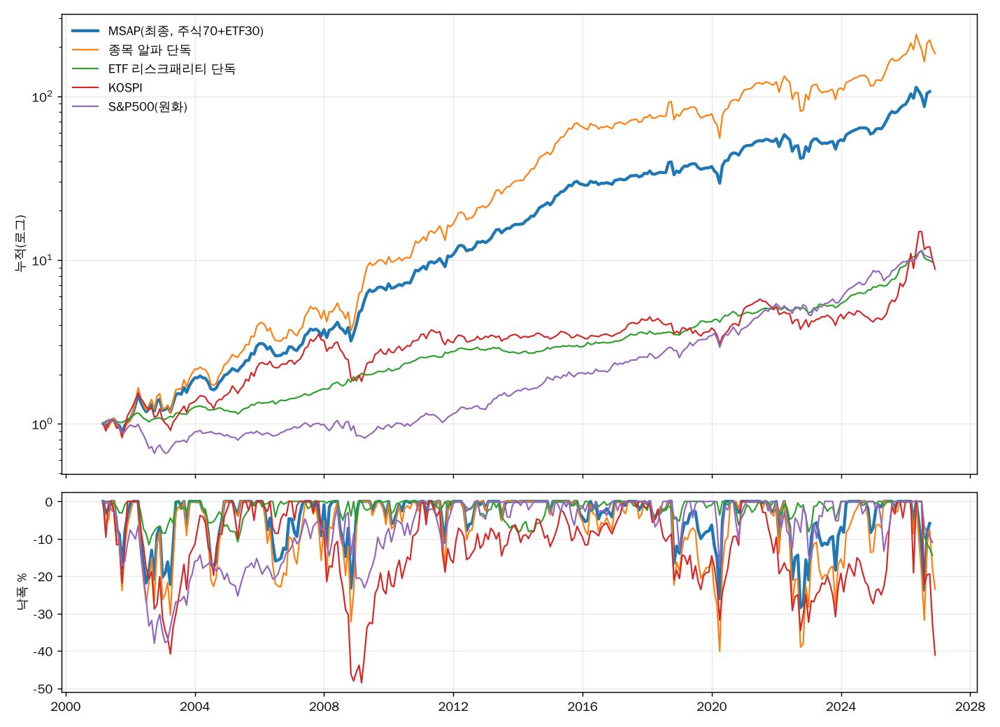

# MSAP 전략 검증 리포트

**MSAP(Multi-Sleeve Adaptive Portfolio)** = 종목 알파 슬리브(머신러닝 랭킹, 70%) + 원화 리스크패리티 ETF 슬리브(30%)

- 데이터: KRX 전종목 일별(1995.05~2026.11, 상장폐지 포함 4,041종목, FinanceData/marcap), 원/달러(FRED H.10), S&P500·금·미국채(공개 데이터셋)
- 비용: NH PLUG 수수료 0.01% + 유관기관 0.0036% + 연도별 증권거래세(0.30%→0.15%→2026년 0.20%) + 유동성 기반 슬리피지(√ 충격모형, 대형주 ≈0.08%·소형주 ≈0.26%)
- 체결: 월말 종가 신호 → 다음 거래일 시가. 거래정지 종목은 매매 불가, 상장폐지 시 30% 손실 가정
- 모델은 매년 그 시점 이전 데이터로만 재학습(워크포워드), 학습·테스트 사이 35일 퍼지
- **IS = 2001~2012(설계·선택), OOS = 2013~2026.11(검증)**. 모델·비중·파라미터는 IS 성과로만 골랐다

## 1. 결론

| 전략 | CAGR | Sharpe | MDD | 최악의 해 | IS CAGR | IS Sharpe | OOS CAGR | OOS Sharpe | OOS MDD |
|---|---:|---:|---:|---:|---:|---:|---:|---:|---:|
| **MSAP 최종** | 20.0% | 0.98 | -28.5% | -16.3% | 24.0% | 1.08 | 16.6% | 0.87 | -28.5% |
| MSAP(딥러닝 앙상블 버전) | 14.4% | 0.82 | -42.4% | -23.6% | 12.1% | 0.67 | 16.4% | 0.98 | -19.8% |
| 종목 알파 단독(LightGBM) | 24.0% | 0.94 | -56.2% | -22.4% | 30.4% | 1.06 | 18.6% | 0.82 | -56.2% |
| ETF 리스크패리티 단독 | 9.2% | 1.10 | -12.7% | -8.1% | 8.7% | 1.06 | 9.5% | 1.12 | -12.7% |
| KOSPI(시총가중, 배당 제외) | 10.6% | 0.56 | -54.7% | -40.7% | 11.8% | 0.57 | 9.4% | 0.54 | -44.0% |
| S&P500 보유(원화) | 9.1% | 0.69 | -40.3% | -29.6% | 0.9% | 0.13 | 16.3% | 1.16 | -17.7% |
| 4자산 균등(원화) | 9.5% | 1.04 | -16.7% | -11.0% | 8.7% | 1.00 | 10.0% | 1.05 | -13.6% |

- Deflated Sharpe Ratio: **0.997** (시험한 설정 300개 보정, 기준 Sharpe 0.42) → 1에 가까울수록 '운 좋은 최댓값'이 아닐 확률이 높다
- 기간: 2001-01 ~ 2026-09-30 (모든 행 동일). 종목 알파 슬리브는 2026-09-30 이후 2026-11-24 까지 -17.2% (표에는 미포함, 공통 종료일 2026-09-30 기준)

## 2. 종목 알파 모델 비교 (상위 15종목·동일가중·월 리밸런싱, 표본외 점수)

| 전략 | CAGR | Sharpe | MDD | 최악의 해 | IS CAGR | IS Sharpe | OOS CAGR | OOS Sharpe | OOS MDD |
|---|---:|---:|---:|---:|---:|---:|---:|---:|---:|
| 규칙기반 합성팩터 (회전율 11.8배/년) | 2.2% | 0.22 | -72.0% | -25.6% | 9.2% | 0.59 | -3.6% | -0.20 | -66.6% |
| 선형(릿지) (회전율 13.1배/년) | 9.9% | 0.60 | -59.5% | -38.8% | 14.7% | 0.75 | 5.9% | 0.44 | -53.8% |
| LightGBM (회전율 15.0배/년) | 24.0% | 0.94 | -56.2% | -22.4% | 30.4% | 1.06 | 18.6% | 0.82 | -56.2% |
| 딥러닝 MLP (회전율 14.9배/년) | 17.1% | 0.75 | -60.8% | -35.2% | 16.2% | 0.69 | 17.8% | 0.82 | -56.1% |
| 딥러닝 Transformer (회전율 14.8배/년) | 13.9% | 0.70 | -61.1% | -40.5% | 15.9% | 0.75 | 12.3% | 0.65 | -55.2% |
| 딥러닝 앙상블(MLP+Transformer) (회전율 14.8배/년) | 16.0% | 0.77 | -60.0% | -36.6% | 13.1% | 0.64 | 18.6% | 0.89 | -49.1% |
| 전체 앙상블(LGBM+DL) (회전율 14.4배/년) | 16.0% | 0.75 | -61.7% | -33.1% | 16.5% | 0.74 | 15.5% | 0.76 | -55.7% |

→ IS Sharpe 기준 선택 모델: **LightGBM**

## 3. 주식 비중 프런티어 (나머지 = ETF 리스크패리티)

| 전략 | CAGR | Sharpe | MDD | 최악의 해 | IS CAGR | IS Sharpe | OOS CAGR | OOS Sharpe | OOS MDD |
|---|---:|---:|---:|---:|---:|---:|---:|---:|---:|
| 주식 50% / ETF 50% | 17.3% | 1.08 | -21.0% | -13.0% | 20.1% | 1.17 | 14.9% | 1.00 | -21.0% |
| 주식 60% / ETF 40% | 18.7% | 1.03 | -24.8% | -14.6% | 22.1% | 1.12 | 15.8% | 0.93 | -24.8% |
| 주식 70% / ETF 30% | 20.0% | 0.98 | -28.5% | -16.3% | 24.0% | 1.08 | 16.6% | 0.87 | -28.5% |
| 주식 80% / ETF 20% | 21.3% | 0.94 | -32.1% | -18.2% | 25.8% | 1.04 | 17.3% | 0.83 | -32.1% |
| 주식 100% / ETF 0% | 23.5% | 0.87 | -40.1% | -22.4% | 29.3% | 0.99 | 18.6% | 0.76 | -40.1% |

## 4. 비용 스트레스 테스트 (MSAP 최종)

| 전략 | CAGR | Sharpe | MDD | 최악의 해 | IS CAGR | IS Sharpe | OOS CAGR | OOS Sharpe | OOS MDD |
|---|---:|---:|---:|---:|---:|---:|---:|---:|---:|
| 기본 비용 | 20.0% | 0.98 | -28.5% | -16.3% | 24.0% | 1.08 | 16.6% | 0.87 | -28.5% |
| 슬리피지 2배 | 18.3% | 0.91 | -28.7% | -17.2% | 21.9% | 1.00 | 15.2% | 0.81 | -28.7% |
| 거래세 0.30% 고정 | 19.9% | 0.97 | -28.6% | -16.6% | 24.0% | 1.08 | 16.3% | 0.86 | -28.6% |
| 상장폐지 손실 100% | 19.7% | 0.96 | -28.5% | -16.3% | 23.3% | 1.04 | 16.6% | 0.87 | -28.5% |

## 5. 연도별 수익률 (2026년은 2026-09-30 까지)

| 연도 | MSAP | 종목 알파 | ETF RP | KOSPI |
|---|---:|---:|---:|---:|
| 2002 | 13.5% | 17.7% | -2.5% | -11.1% |
| 2003 | 58.3% | 76.4% | 18.8% | 28.2% |
| 2004 | 5.2% | 9.0% | -4.7% | 10.6% |
| 2005 | 53.7% | 75.1% | 12.1% | 54.6% |
| 2006 | -4.7% | -9.3% | 5.5% | 4.3% |
| 2007 | 27.6% | 32.2% | 14.6% | 32.8% |
| 2008 | 7.5% | 2.8% | 11.7% | -40.7% |
| 2009 | 77.4% | 107.0% | 19.3% | 49.8% |
| 2010 | 23.9% | 26.3% | 16.9% | 22.1% |
| 2011 | 21.7% | 25.7% | 8.2% | -10.6% |
| 2012 | 18.2% | 25.5% | 2.1% | 9.4% |
| 2013 | 29.1% | 46.3% | -4.4% | 0.8% |
| 2014 | 31.8% | 43.8% | 6.6% | -4.6% |
| 2015 | 33.3% | 48.3% | 3.2% | 2.9% |
| 2016 | 5.9% | 4.5% | 8.1% | 3.3% |
| 2017 | 9.8% | 9.1% | 10.9% | 22.9% |
| 2018 | 1.7% | 1.7% | -1.6% | -17.0% |
| 2019 | 8.8% | 3.6% | 20.6% | 7.7% |
| 2020 | 32.1% | 39.2% | 11.7% | 31.1% |
| 2021 | 12.0% | 12.7% | 10.1% | 3.5% |
| 2022 | -16.3% | -22.4% | -8.1% | -25.2% |
| 2023 | 17.8% | 18.0% | 14.4% | 19.4% |
| 2024 | 10.0% | 3.2% | 26.3% | -10.1% |
| 2025 | 49.5% | 55.5% | 34.6% | 76.5% |
| 2026 | 19.8% | 22.1% | 7.4% | 62.7% |

## 6. 팩터 IC (월간 순위상관, 높을수록 다음 달 수익 예측력)

| 팩터 | IS IC | IS t | OOS IC | OOS t |
|---|---:|---:|---:|---:|
| max_21 | -0.099 | -12.5 | -0.066 | -6.1 |
| vol_20 | -0.107 | -9.8 | -0.070 | -5.7 |
| idio_vol | -0.114 | -9.8 | -0.084 | -6.8 |
| turnover | -0.109 | -8.8 | -0.071 | -5.2 |
| vol_60 | -0.108 | -8.7 | -0.081 | -5.9 |
| gap_20 | -0.062 | -8.4 | -0.033 | -3.9 |
| amt_trend | -0.050 | -6.1 | -0.017 | -2.0 |
| vol_ratio | -0.033 | -5.1 | -0.004 | -0.8 |
| r_1w | -0.044 | -5.1 | -0.018 | -2.2 |
| r_1m | -0.048 | -4.8 | -0.028 | -3.0 |
| lo_52 | -0.047 | -4.7 | -0.044 | -3.4 |
| ma50 | -0.051 | -4.6 | -0.033 | -3.3 |
| up_ratio | -0.026 | -3.5 | -0.019 | -2.6 |
| r_3m | -0.025 | -2.2 | -0.028 | -2.5 |
| skew_60 | -0.010 | -1.6 | -0.037 | -5.8 |
| ma200 | -0.016 | -1.3 | -0.027 | -2.1 |
| amihud | -0.008 | -0.9 | +0.000 | +0.0 |
| beta | -0.003 | -0.2 | -0.028 | -1.9 |
| mom_6_1 | +0.012 | +1.2 | -0.009 | -0.8 |
| mom_12_1 | +0.028 | +2.5 | -0.007 | -0.6 |
| hi_52 | +0.037 | +2.7 | +0.022 | +1.8 |
| size | +0.045 | +3.8 | +0.029 | +3.2 |
| age | +0.043 | +4.5 | +0.025 | +4.0 |
| price | +0.053 | +4.8 | +0.021 | +2.5 |
| min_21 | +0.077 | +7.5 | +0.053 | +4.9 |

## 7. 한계
- 과거 성과는 미래를 보장하지 않는다. 특히 OOS 수익률이 IS 보다 낮다(알파 감소).
- 종목 데이터는 배당 제외 가격수익률(보수적). ETF 슬리브의 월평균 시계열은 1개월 체결지연으로 평활편향 제거.
- 원화 현금수익은 한국은행 기준금리 연평균 근사치.
- 15종목 집중 포트폴리오라 개별 종목 사건 위험이 있다. 운용자금이 크면(수십억+) 슬리피지가 커진다.