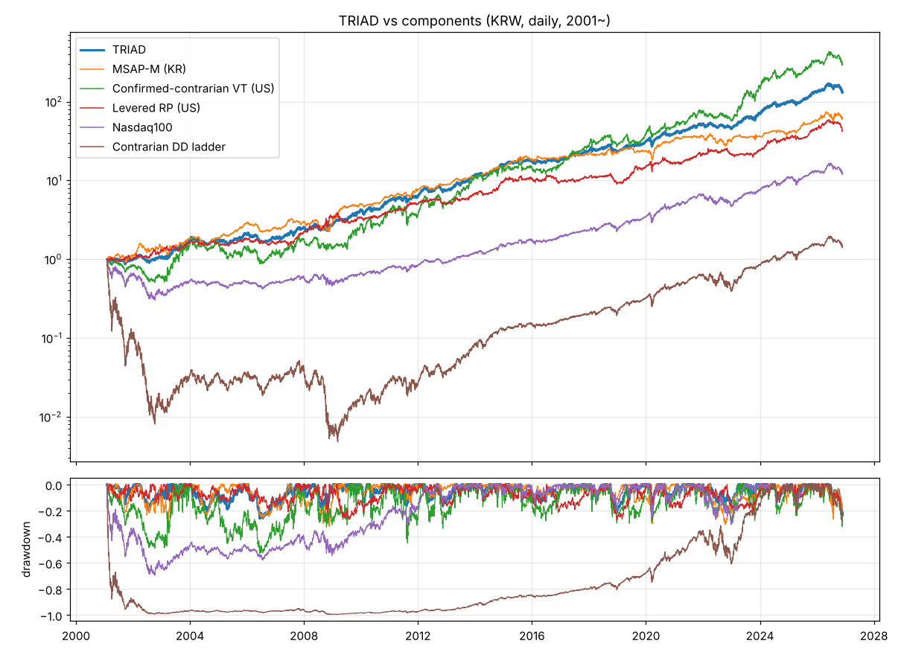

# 전략 토너먼트 → 최종 전략 TRIAD

> 질문: "전설적인 투자자들의 검증된 전략을 모두 참고해 최고의 전략을 만들어라. 낙폭이 과도할 때 역발상으로 더 사고 레버리지를 쓰는 건 어떤가? 기존에 알림 받는 두 전략도 참고하라."

## 1. 결론

**TRIAD = 한국 종목 알파(MSAP-M) ⅓ + 미국 확인형 역발상 변동성 타기팅 ⅓ + 미국 레버리지 리스크패리티 ⅓**

| | CAGR | 세후(근사) | Sharpe | 일별 MDD | 2016~ | 2016~ MDD | 최악의 해 | 5년 롤링 최저 |
|---|---|---|---|---|---|---|---|---|
| **TRIAD (2005~)** | 21.7% | 18.5% | 1.19 | -26.2% | 20.4% | -24.1% | -12.9% | 12.1% |
| [기존] 고금리·3차·AQUILA 1/3씩 | 22.0% | 17.3% | 0.93 | -36.1% | 22.5% | -36.1% | -18.6% | 13.5% |
| 나스닥100 보유 | 15.8% | 11.8% | 0.75 | -30.6% | 19.7% | -30.6% | -28.5% | 5.6% |
| 보글: S&P500 보유 | 11.8% | 9.0% | 0.65 | -29.6% | 15.5% | -29.6% | -14.8% | 1.9% |
| KOSPI200 보유 | 8.0% | 8.0% | 0.45 | -54.9% | 9.3% | -49.7% | -40.8% | -2.8% |
| 60/40(주식/중기채) | 9.2% | 7.1% | 0.70 | -17.6% | 10.3% | -17.6% | -11.6% | 5.3% |

* 닷컴 붕괴를 포함한 **2001~2026.11 전체: CAGR 20.9%, Sharpe 1.14, MDD -26.2%** (같은 기간 나스닥100 MDD -71.1%).
* 실전처럼 레그 간 비중이 ±10%p 벗어날 때만 환전(비용 0.2%)해도 CAGR 21.5%, MDD -26.5%.
* 6,600여 개 설정을 시험한 것을 보정한 Deflated Sharpe(2016~ 표본): **0.95** (IS 최적화 조합은 0.85) — 운 좋은 최댓값일 확률이 낮다는 뜻.
* 기존 세 전략(사용자 알림 전략 근사)과 수익은 비슷하고(22.0% vs 21.7%) **Sharpe 0.93 → 1.19, MDD -36.1% → -26.2%** 으로 위험이 크게 줄었다. 핵심은 미국 레버리지 추세군과 상관 0.1~0.3 인 '한국 종목 알파' 엔진을 더한 것.
* ⚠️ 2026-11-24 현재 TRIAD 는 고점 대비 **-22.0%** 낙폭 중(나스닥·코스피 동반 조정). 과거 최대낙폭(−26%)을 넘을 수 있다는 전제로 비중을 정하세요.



## 2. 같은 조건에서 공정하게 비교했다

* **원화 기준 일별** 수익(환율 반영), 일별 MDD(월말 MDD 의 함정 제거). 신호 t일 종가 → **t+1일 매매**.
* 비용: 해외 편도 0.10%(NH 해외 0.09%+스프레드), 국내 ETF 0.03%. 레버리지 ETF 는 일일 리셋 합성 `L·r − (L−1)·단기금리 − 연 0.95%`(변동성 손실 자동 반영). 한국 종목 슬리브는 실제 거래세·슬리피지·유동성 한도 반영.
* 데이터: 미국 ETF 1999~, 상장 전 금·채권·원자재는 장기 총수익지수로 보강, 한국은 생존편향 없는 KRX 전종목.
* 검증: 2005~2015(IS) / 2016~(OOS) 분리, 5년 롤링 최저, 세후 근사(해외 양도세 22%, 손실이월·공제 무시 → 보수적), 1971~ 미국 장기 꼬리위험 검증, Deflated Sharpe.
* 한계: 버핏·그레이엄·린치·그린블랫·피오트로스키 같은 **재무제표 기반 전략은 무료 시점별(point-in-time) 재무 데이터가 없어 시험하지 못했다**(현재 재무로 과거를 시험하면 미래참조). 사용자 기존 전략은 알림 메시지에서 읽은 규칙으로 만든 **근사**다.

## 3. 토너먼트 결과(31개, 2005~ 공통구간)

| 전략 | 분류 | CAGR | 세후 | Sharpe | MDD | Calmar | 최악의 해 | 2005~15 | 2016~ | 2001~ CAGR | 2001~ MDD |
|---|---|---|---|---|---|---|---|---|---|---|---|
| 60/40(주식/중기채) | A 수동형 | 9.2% | 7.1% | 0.70 | -17.6% | 0.52 | -11.6% | 8.0% | 10.3% | 7.4% | -28.6% |
| 나스닥100 보유 | A 수동형 | 15.8% | 11.8% | 0.75 | -30.6% | 0.51 | -28.5% | 12.0% | 19.7% | 11.0% | -71.1% |
| 골든 버터플라이 | A 수동형 | 8.8% | 6.7% | 0.72 | -20.0% | 0.44 | -9.8% | 8.4% | 9.0% | 7.7% | -20.4% |
| 달리오 올웨더 | A 수동형 | 7.7% | 5.7% | 0.64 | -18.2% | 0.42 | -14.4% | 8.0% | 7.2% | 6.6% | -18.2% |
| 버핏 90/10 | A 수동형 | 11.0% | 8.5% | 0.66 | -26.1% | 0.42 | -11.7% | 7.9% | 14.3% | 8.5% | -41.5% |
| 브라운 영구포트폴리오 | A 수동형 | 8.2% | 6.1% | 0.70 | -19.4% | 0.42 | -9.8% | 8.0% | 8.1% | 7.0% | -19.4% |
| 보글: S&P500 보유 | A 수동형 | 11.8% | 9.0% | 0.65 | -29.6% | 0.40 | -14.8% | 8.2% | 15.5% | 9.0% | -45.4% |
| KOSPI200 보유 | A 수동형 | 8.0% | 8.0% | 0.45 | -54.9% | 0.15 | -40.8% | 6.8% | 9.3% | 8.8% | -54.9% |
| 골든크로스 QQQ 1배 | B 추세·모멘텀 | 12.6% | 9.6% | 0.71 | -28.3% | 0.44 | -9.1% | 8.4% | 17.0% | 11.5% | -33.8% |
| 켈러 HAA | B 추세·모멘텀 | 8.2% | 6.3% | 0.60 | -19.6% | 0.42 | -2.3% | 8.7% | 7.5% | 8.2% | -19.6% |
| 골든크로스 TQQQ(3배) | B 추세·모멘텀 | 22.2% | 15.9% | 0.65 | -68.8% | 0.32 | -35.5% | 13.4% | 32.5% | 21.9% | -73.0% |
| 터틀 돌파(55/20일) | B 추세·모멘텀 | 5.4% | 4.0% | 0.49 | -20.1% | 0.27 | -7.1% | 4.2% | 6.3% | 4.0% | -23.5% |
| 안토나치 듀얼모멘텀 GEM | B 추세·모멘텀 | 9.4% | 7.0% | 0.59 | -35.5% | 0.26 | -11.7% | 9.5% | 9.2% | 9.2% | -35.5% |
| 페이버 GTAA5(10개월선) | B 추세·모멘텀 | 5.7% | 4.3% | 0.52 | -22.5% | 0.25 | -7.4% | 5.3% | 6.0% | 5.4% | -22.5% |
| 변동성 타기팅 QQQ 25%(최대 3배) | C 변동성·RP | 20.8% | 15.9% | 0.78 | -34.5% | 0.60 | -24.3% | 15.9% | 26.4% | 16.4% | -50.9% |
| 레버리지 리스크패리티 18%+추세 | C 변동성·RP | 16.4% | 12.5% | 0.84 | -28.6% | 0.57 | -15.2% | 19.1% | 13.7% | 15.5% | -28.6% |
| VIX 35 공포 매수 S&P500 2배 | D 역발상 | 13.6% | 10.1% | 0.57 | -65.2% | 0.21 | -43.7% | 6.9% | 20.7% | 10.7% | -65.2% |
| 역발상 낙폭 사다리 QQQ(−20/−30/−40% → 1.5/2/3배) | D 역발상 | 18.8% | 12.9% | 0.60 | -90.8% | 0.21 | -84.3% | 14.6% | 23.2% | 3.3% | -99.6% |
| 역발상+반등확인 QQQ(낙폭 & 50일선 위) | D 역발상 | 17.8% | 12.1% | 0.59 | -90.8% | 0.20 | -84.3% | 14.6% | 21.2% | 1.6% | -99.6% |
| 역발상 낙폭 사다리 S&P500 | D 역발상 | 13.5% | 9.9% | 0.53 | -77.7% | 0.17 | -48.9% | 8.8% | 18.5% | 10.9% | -77.7% |
| 역발상 낙폭 사다리 KOSPI200(최대 2배) | D 역발상 | 8.6% | 8.6% | 0.41 | -73.2% | 0.12 | -59.9% | 10.7% | 6.8% | 9.0% | -74.9% |
| 역발상·확인형: 폭락 후 골든크로스 1년 3배 + VT25% | D' 안전한 역발상 | 27.1% | 20.8% | 0.83 | -45.6% | 0.59 | -24.8% | 22.3% | 32.5% | 25.0% | -52.7% |
| 역발상·안전형: 낙폭 사다리 + 추가하락 −25% 손절 QQQ | D' 안전한 역발상 | 17.4% | 13.1% | 0.75 | -43.0% | 0.41 | -36.5% | 12.0% | 23.2% | 12.4% | -71.1% |
| 역발상·안전형: 고정비중 리밸런싱 TQQQ 1/3 + 중기채 2/3 | D' 안전한 역발상 | 15.9% | 11.8% | 0.80 | -40.6% | 0.39 | -38.8% | 14.5% | 17.3% | 11.8% | -66.0% |
| 역발상·안전형: 강세장 눌림목 QQQ(200일선 위 & −8% → 2배) | D' 안전한 역발상 | 11.1% | 8.1% | 0.60 | -34.0% | 0.33 | -25.2% | 8.8% | 13.6% | 8.5% | -38.9% |
| 역발상·안전형: 강세장 눌림목 S&P500 | D' 안전한 역발상 | 8.1% | 5.8% | 0.57 | -30.5% | 0.27 | -19.3% | 5.7% | 10.6% | 7.3% | -30.5% |
| MSAP-M(종목 70 + ETF RP 30) | E 종목선택(한국) | 17.3% | 17.3% | 1.02 | -32.1% | 0.54 | -15.1% | 23.3% | 11.8% | 17.3% | -32.1% |
| 한국 종목 알파(ML·미너비니 손절) | E 종목선택(한국) | 19.9% | 19.9% | 0.90 | -47.4% | 0.42 | -20.1% | 29.2% | 11.5% | 20.2% | -47.4% |
| [기존] AQUILA-X(근사) | F 기존 전략 | 19.7% | 15.3% | 0.85 | -33.0% | 0.60 | -12.7% | 17.6% | 21.8% | 19.7% | -33.0% |
| [기존] 고금리 대비형(근사) | F 기존 전략 | 22.5% | 18.4% | 0.94 | -41.1% | 0.55 | -19.3% | 20.3% | 24.8% | 20.2% | -41.1% |
| [기존] 3차 공격형(근사) | F 기존 전략 | 21.8% | 16.4% | 0.83 | -41.0% | 0.53 | -23.7% | 24.0% | 19.8% | 20.4% | -41.0% |

읽는 법: 전설적 자산배분(A)은 MDD 가 작지만 원화 기준 연 8~11%. 추세·모멘텀(B)의 고전 규칙은 2008 이후 수익이 낮다(GTAA 5.7%, 터틀 5.4%). 20%를 넘는 것은 **레버리지를 변동성·추세로 통제한 전략(C·F)** 과 **한국 종목 알파(E)** 뿐이다.

## 4. "낙폭이 클 때 역발상으로 더 사고 레버리지" — 데이터의 답

**무조건 역발상 레버리지는 파산형이다.** 고점 대비 −20/−30/−40% 에서 1.5/2/3배로 늘리는 사다리는 2005~ CAGR 18.8% 로 높아 보이지만 **MDD -90.8%**, 2001년에 시작했다면 **CAGR 3.3%, MDD -99.6%** 였다. 2000~2002년 나스닥은 −83%까지 빠졌고, '충분히 빠졌다'고 레버리지를 늘린 지점들 아래로 또 반토막이 났다.

1971년부터 S&P500(달러)으로 다시 시험해도 같다(1973~74, 1987, 2000~02, 2008 포함):

| 1971~ 미국 | CAGR | Sharpe | MDD | 최악의 해 | 1970s | 1980s | 1990s | 2000s | 2010s |
|---|---|---|---|---|---|---|---|---|---|
| S&P500 보유 | 11.0% | 0.69 | -55.3% | -37.0% | 5.9% | 17.4% | 18.0% | -0.9% | 13.4% |
| S&P500 3배 보유 | 13.1% | 0.50 | -98.0% | -85.7% | -2.1% | 21.5% | 38.6% | -21.4% | 33.8% |
| 역발상 낙폭 사다리(−20/−30/−40% → 1.5/2/3배) | 12.6% | 0.54 | -86.0% | -62.1% | 8.1% | 19.1% | 18.0% | -2.0% | 16.4% |
| 역발상 사다리 + 추가하락 −25% 손절 | 10.1% | 0.58 | -72.3% | -49.5% | 2.7% | 19.1% | 18.0% | -6.9% | 13.4% |
| 골든크로스 3배 | 15.2% | 0.56 | -76.6% | -44.2% | 5.2% | 19.2% | 25.5% | 12.3% | 17.5% |
| 변동성 타기팅 25%(최대 3배) | 14.3% | 0.61 | -68.4% | -39.6% | 2.7% | 22.7% | 28.0% | -2.5% | 22.6% |
| 확인형 역발상(폭락 후 골든크로스 1년 3배)+VT25% | 16.4% | 0.64 | -68.8% | -39.6% | 3.5% | 23.2% | 28.0% | 1.6% | 22.0% |

왜 그런가: ① 레버리지 ETF 는 하락장의 변동성 손실로 기초자산보다 훨씬 깊게 빠진다(3배 보유 MDD −98%). ② 폭락은 '평균 회귀'보다 '추세 지속'이 먼저 온다 — 변동성이 높을 때 레버리지를 늘리는 것은 Moreira–Muir(2017)가 보인 것과 정반대(고변동성일 때 줄여야 위험 대비 수익이 오른다). ③ 손절을 붙여도(−72%) VIX 공포 매수(−65%)도 꼬리를 못 막는다.

**하지만 아이디어의 핵심 — '공포 뒤의 회복은 크다' — 는 맞다.** 그래서 순서를 바꿨다: 폭락 '중'이 아니라, **최근 2년 안에 사상 최고가 대비 −30% 이하까지 빠졌던 자산에서 골든크로스(50일선이 200일선을 새로 상향 돌파)로 추세 회복이 확인된 뒤** 1년간 3배로 싣는다(골든크로스가 깨지면 해제). 템플턴의 '최대 비관의 시점'을 추세로 확인하는 방식으로, 나스닥에서는 2003~2013년(2000년 고점 아래 구간)과 2023년에 11번 발동했다.

| | 2005~ CAGR | MDD | 2016~ | 2001~ CAGR |
|---|---|---|---|---|
| 변동성 타기팅 25% | 20.8% | -34.5% | 26.4% | 16.4% |
| **확인형 역발상 + VT 25%** | **27.1%** | -45.6% | 32.5% | 25.0% |

* 과최적화 점검: 폭락 기준(−20~−40%)·유지기간(6~18개월)·배수(2~3배) **45개 조합 모두**가 VT 단독보다 CAGR 이 높았다(중앙값 25.3%, 범위 21.7%~32.0%). 배수 2배면 CAGR 23.8%·MDD -34.7%, 3배면 27.1%·-45.6%.
* 표본 밖 검증: 이 규칙을 만들 때 보지 않은 1971~2000년 S&P500 에서도 VT 단독 대비 우위(1971~ CAGR 16.4% vs 14.3%, MDD 동일).
* 단, 단독으로는 MDD −46% 라 TRIAD 안에서 ⅓ 비중으로만 쓴다.

## 5. 기존 두 전략(알림 받는 전략) 평가

* **[기존] 고금리 대비형(근사)**: CAGR 22.5%, Sharpe 0.94, MDD -41.1%, 2016~ 24.8% — 토너먼트 상위권. 설계가 좋다.
* **[기존] 3차 공격형(근사)**: CAGR 21.8%, Sharpe 0.83, MDD -41.0%, 2016~ 19.8% — 토너먼트 상위권. 설계가 좋다.
* **[기존] AQUILA-X(근사)**: CAGR 19.7%, Sharpe 0.85, MDD -33.0%, 2016~ 21.8% — 토너먼트 상위권. 설계가 좋다.

세 전략 모두 '나스닥 추세·변동성 레버리지' 또는 '레버리지 리스크패리티'에 속해 서로 상관이 0.7~0.9 로 높다(아래 표). 셋을 섞어도 MDD 가 -36% 로 남는 이유다. TRIAD 의 미국 두 엔진은 이 둘의 대표(고금리 대비형/AQUILA ≈ VT 계열, 3차 공격형 ≈ 레버리지 RP, 상관 0.83~0.89)이고, 여기에 상관 0.09~0.31 인 한국 종목 엔진을 더해 위험을 낮췄다.

| 주간 상관 | KR | VT | VT+ | HR | A3 | AQ | LRP |
|---|---|---|---|---|---|---|---|
| KR | 1.00 | 0.31 | 0.31 | 0.38 | 0.22 | 0.27 | 0.09 |
| VT | 0.31 | 1.00 | 0.94 | 0.85 | 0.65 | 0.92 | 0.42 |
| VT+ | 0.31 | 0.94 | 1.00 | 0.83 | 0.58 | 0.88 | 0.35 |
| HR | 0.38 | 0.85 | 0.83 | 1.00 | 0.77 | 0.91 | 0.56 |
| A3 | 0.22 | 0.65 | 0.58 | 0.77 | 1.00 | 0.71 | 0.89 |
| AQ | 0.27 | 0.92 | 0.88 | 0.91 | 0.71 | 1.00 | 0.50 |
| LRP | 0.09 | 0.42 | 0.35 | 0.56 | 0.89 | 0.50 | 1.00 |

(KR=MSAP-M, VT=변동성 타기팅, VT+=확인형 역발상, HR=고금리 대비형, A3=3차 공격형, AQ=AQUILA-X, LRP=레버리지 RP)

## 6. 조합은 '최적화'보다 '단순 규칙'이 강했다

| 배분 규칙(2005~) | CAGR | 세후(근사) | Sharpe | 일별 MDD | 2005~15 | 2016~ | 2016~ MDD | 최악의 해 | 나스닥 β 최대 |
|---|---|---|---|---|---|---|---|---|---|
| IS 규칙 최적 조합 | 19.6% | 16.0% | 1.07 | -30.1% | 20.7% | 18.5% | -30.1% | -9.7% | 1.38 |
| TRIAD: 한국 MSAP-M + 확인형 역발상 VT + 레버리지 RP (각 1/3) | 21.7% | 18.5% | 1.19 | -26.2% | 23.3% | 20.4% | -24.1% | -12.9% | 1.54 |
| 7슬리브 동일가중 | 22.3% | 18.2% | 1.04 | -30.5% | 22.4% | 22.4% | -30.5% | -16.8% | 1.84 |
| 6슬리브 동일가중(VT 제외) | 22.2% | 18.2% | 1.07 | -30.3% | 23.0% | 21.6% | -30.3% | -15.5% | 1.72 |
| 6슬리브 동일가중(확인형 역발상 제외) | 20.8% | 17.1% | 1.05 | -30.3% | 21.3% | 20.5% | -30.3% | -15.5% | 1.66 |
| 클러스터 1/3(한국 / 나스닥 추세군 / 멀티에셋 RP군) | 21.0% | 18.0% | 1.19 | -26.8% | 23.2% | 19.3% | -26.8% | -14.5% | 1.42 |
| 한국 30 + 미국 6슬리브 동일 | 21.5% | 18.3% | 1.14 | -27.2% | 22.6% | 20.7% | -27.2% | -16.0% | 1.52 |
| 한국 50 + 미국 6슬리브 동일 | 20.3% | 18.1% | 1.26 | -24.6% | 22.7% | 18.4% | -24.6% | -15.3% | 1.13 |
| [기존] 3전략 1/3(고금리·3차·AQUILA) | 22.0% | 17.3% | 0.93 | -36.1% | 21.6% | 22.5% | -36.1% | -18.6% | 1.91 |
| 한국 + [기존] 3전략 1/4 | 21.1% | 17.8% | 1.09 | -30.4% | 22.2% | 20.3% | -30.4% | -16.8% | 1.47 |

* 사전에 정한 규칙(IS 2005~2015 에서 CAGR ≥ 20% 중 Calmar 최대, 10% 단위 격자 6,538개)으로 고른 조합은 IS 20.7% → OOS 18.5% 로 식었다(전형적인 과최적화 감쇠). 반면 최적화 없는 단순 배분들은 **어느 것을 골라도 CAGR 20~22%, MDD −25~−31%** — 결론이 배분 방식에 둔감하다(DeMiguel 외 2009 '1/N' 결과와 같은 현상).
* 그중 TRIAD(서로 다른 세 엔진 1/3씩)를 택한 이유: 가장 단순(엔진 3개)하고, 2016~ Sharpe(1.18)·MDD(-24.1%)가 모든 배분 규칙 중 가장 좋으며, 세 엔진이 각각 다른 '전설'의 검증된 원리(오닐·미너비니의 종목 모멘텀과 손절, 변동성 관리+템플턴식 역발상, 달리오의 리스크패리티)라서. 고른 뒤의 선택 편향은 아래 Deflated Sharpe 에 시험 횟수로 반영했다.

## 7. TRIAD 상세

| 구간 | CAGR | Sharpe | MDD | 최악의 해 | 5년 롤링 최저 |
|---|---|---|---|---|---|
| TRIAD 매월 리밸런싱 · 2001~ 전체 | 20.9% | 1.14 | -26.2% | -12.9% | 7.4% |
| TRIAD 매월 리밸런싱 · 2005~ | 21.7% | 1.19 | -26.2% | -12.9% | 12.1% |
| TRIAD 매월 리밸런싱 · 2001~2004 | 16.4% | 0.93 | -20.8% | 1.8% | — |
| TRIAD 매월 리밸런싱 · 2005~2015 | 23.3% | 1.20 | -26.2% | -10.5% | 17.1% |
| TRIAD 매월 리밸런싱 · 2016~ | 20.4% | 1.18 | -24.1% | -12.9% | 13.5% |
| TRIAD 매월 리밸런싱 · 최근 5년 | 21.2% | 1.16 | -24.1% | -12.9% | 21.2% |
| TRIAD ±10%p 밴드 리밸런싱 · 2001~ 전체 | 20.5% | 1.10 | -26.5% | -13.4% | 6.9% |
| TRIAD ±10%p 밴드 리밸런싱 · 2005~ | 21.5% | 1.13 | -26.5% | -13.4% | 12.0% |
| TRIAD ±10%p 밴드 리밸런싱 · 2001~2004 | 16.0% | 0.90 | -21.8% | 1.3% | — |
| TRIAD ±10%p 밴드 리밸런싱 · 2005~2015 | 23.1% | 1.16 | -26.5% | -11.4% | 17.7% |
| TRIAD ±10%p 밴드 리밸런싱 · 2016~ | 20.0% | 1.12 | -25.9% | -13.4% | 12.7% |
| TRIAD ±10%p 밴드 리밸런싱 · 최근 5년 | 20.5% | 1.09 | -25.9% | -13.4% | 20.6% |

**연도별 수익(원화, %)**

| 연도 | TRIAD | MSAP-M | 확인형 역발상 VT | 레버리지 RP | 나스닥100 | KOSPI200 |
|---|---|---|---|---|---|---|
| 2002 | 3.2 | 13.2 | -30.5 | 28.7 | -43.4 | -12.1 |
| 2003 | 75.1 | 48.6 | 175.5 | 23.9 | 50.4 | 28.6 |
| 2004 | 1.8 | 2.1 | 5.0 | -4.0 | -4.0 | 9.6 |
| 2005 | 12.5 | 53.6 | -23.5 | 14.6 | -0.9 | 50.6 |
| 2006 | -10.5 | -12.8 | -9.4 | -11.8 | -1.3 | 4.3 |
| 2007 | 39.7 | 19.8 | 57.4 | 39.3 | 19.8 | 32.7 |
| 2008 | 5.2 | -5.0 | -24.8 | 51.1 | -21.4 | -40.8 |
| 2009 | 56.6 | 74.9 | 102.0 | 1.5 | 42.6 | 49.2 |
| 2010 | 31.0 | 24.3 | 44.4 | 19.7 | 16.7 | 22.2 |
| 2011 | 12.3 | 19.4 | -9.0 | 24.1 | 6.0 | -11.1 |
| 2012 | 19.8 | 17.0 | 38.8 | 0.7 | 8.4 | 9.1 |
| 2013 | 60.0 | 28.3 | 129.0 | 36.3 | 35.6 | 0.2 |
| 2014 | 31.0 | 30.8 | 23.0 | 38.1 | 23.2 | -6.5 |
| 2015 | 14.9 | 28.7 | 4.3 | 10.5 | 17.3 | 1.0 |
| 2016 | 1.2 | 4.7 | 5.5 | -8.4 | 10.3 | 3.4 |
| 2017 | 28.7 | 8.6 | 71.0 | 13.5 | 17.6 | 25.9 |
| 2018 | -0.9 | 4.8 | 6.6 | -15.2 | 4.1 | -17.7 |
| 2019 | 34.0 | 5.7 | 35.7 | 57.9 | 44.3 | 7.2 |
| 2020 | 28.5 | 39.9 | 27.4 | 14.9 | 39.5 | 33.2 |
| 2021 | 31.2 | 9.5 | 55.9 | 29.7 | 39.4 | 1.3 |
| 2022 | -12.9 | -15.1 | -24.3 | -1.4 | -28.5 | -26.6 |
| 2023 | 59.2 | 18.9 | 175.5 | 13.0 | 58.6 | 22.2 |
| 2024 | 35.6 | 7.4 | 61.1 | 41.0 | 43.8 | -11.1 |
| 2025 | 33.8 | 45.7 | 25.9 | 28.3 | 18.0 | 79.0 |
| 2026 | 1.3 | 7.6 | -4.7 | -2.8 | -3.1 | 17.0 |

**위기 구간**

| 구간 | TRIAD | 나스닥100 | KOSPI200 |
|---|---|---|---|
| 2001~02 닷컴 | -2.0% | -69.5% | -4.2% |
| 2008 금융위기 | 26.9% | -18.7% | -46.7% |
| 2011 유럽위기 | -7.0% | -4.0% | -19.0% |
| 2018 Q4 | -21.2% | -21.5% | -12.4% |
| 2020 코로나 | -19.0% | -23.3% | -31.9% |
| 2022 금리급등 | -10.5% | -21.8% | -26.7% |
| 2024.08 엔캐리 | -12.2% | -14.1% | -10.9% |
| 2026.10~11 조정 | -17.1% | -14.7% | -25.3% |

**레버리지 ETF 비용 민감도**(실제 스왑 금리는 단기금리보다 높다):

| 추가 금융비용 | TRIAD CAGR | Sharpe | MDD | 2016~ |
|---|---|---|---|---|
| 스왑 스프레드 +0.0% | 21.7% | 1.19 | -26.2% | 20.4% |
| 스왑 스프레드 +0.5% | 21.4% | 1.17 | -26.4% | 20.1% |
| 스왑 스프레드 +1.0% | 21.0% | 1.15 | -26.5% | 19.8% |

**꼬리위험**: TRIAD 의 나스닥 63일 β 는 중앙값 0.84, 최대 1.54. 1987년 블랙먼데이 같은 하루 −20% 가 오면 이론상 하루 −17%(보통) ~ −31%(부스트 최대 노출) 손실이 가능하다. 백테스트 최악의 하루는 -8.9%. 3배 상품의 하루 갭 위험은 손절로 막을 수 없으므로 감당할 수 없다면 `boost_leverage: 2.0` 을 쓰세요(확인형 역발상 엔진 기준 CAGR -3.3%p, MDD -45.6% → -34.7%).

## 8. 실전 운용

| 레그 | 비중 | 설정 | 계좌 | 실행 시각 |
|---|---|---|---|---|
| 국내: MSAP-M | ⅓ | `config/default.yaml` | NH 국내(원화) | 매 거래일 09:30 KST |
| 미국: 확인형 역발상 VT + 레버리지 RP | ⅔ | `config/triad_us.yaml` | NH 해외(달러) | 매 거래일 10:30 ET |

```bash
autotrader --config config/triad_us.yaml signal          # 미국 레그 목표비중·부스트 상태
autotrader --config config/triad_us.yaml rebalance --dry-run
autotrader --config config/triad_us.yaml daemon          # 모의투자로 먼저
autotrader triad                                          # 레그 간 배분 점검·환전 권고
```

* 미국 레그 매매 상품: QQQ·TQQQ(3배)·TLT·TMF(3배)·GLD·UGL(2배)·DBC·SGOV(현금). 신호는 백테스트와 **같은 함수**(`research.tournament`)를 호출하며, 과거 40개월 신호가 백테스트와 정확히 일치하는 것을 확인했다.
* 레그 간 배분은 ±10%p 를 벗어날 때만 수동 환전(`autotrader triad` 가 금액을 알려줌). 환전 우대율을 확인하세요.
* 확인할 것: 해외 레버리지 ETP 매매 요건(사전교육·기본예탁금 등 금융당국 규제), NH PLUG 해외주식 API 신청, 해외 양도소득세(연 250만원 공제 후 22%, 다음 해 5월 신고).
* 세후 수익은 계좌 구조에 따라 달라진다. 국내 레그 종목 매매차익은 대주주가 아니면 비과세다.

## 9. 정직한 한계

* '부스트' 발동은 25년간 11번이고 그중 대부분이 2000년 고점 회복 전(2003~2013) 한 국면에 몰려 있다. 45개 설정·1971년 이후 검증으로 보완했지만 독립 사례는 많지 않다(2008.06 발동처럼 곧바로 실패한 사례도 있다).
* 레버리지 ETF 는 합성 수익률이다(실제 추적오차·스왑 비용은 위 민감도 참조).
* 한국 종목 엔진(MSAP-M)의 최근 10년 수익은 초기보다 낮다(2016~ 11.8%) — 단독이 아니라 ⅓ 로 둔 이유 중 하나.
* 미래 수익을 보장하지 않는다. 모의투자 → 소액 실전 → 증액 순서를 지키세요.
